# Josh Guarino
I am an experienced Software Engineer with 8+ years as a Software Engineer and 5 years as QA/SDET Engineer, with 12+
years in total. Expertise in a variety of programming languages and technologies.
### GitHub Stats

   
   
   

### Trophies

   

### Contribution Graph

   

### Snake

   

### Tech Stack

   

### Support Me

   

